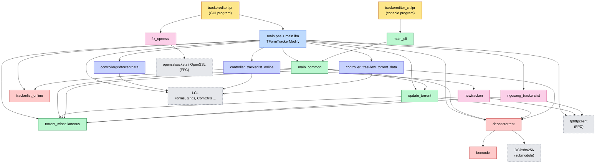
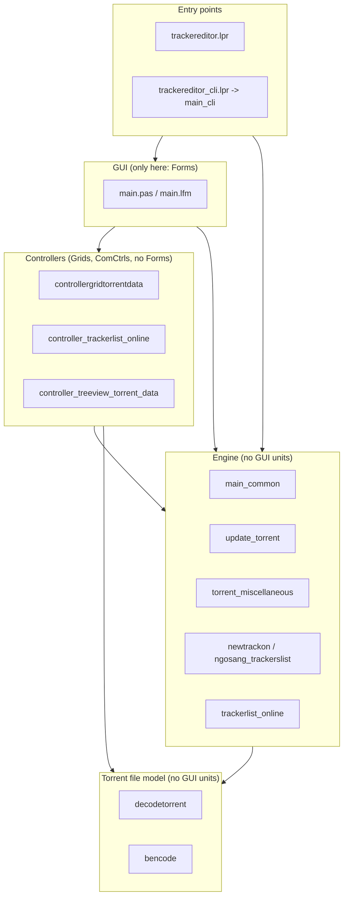
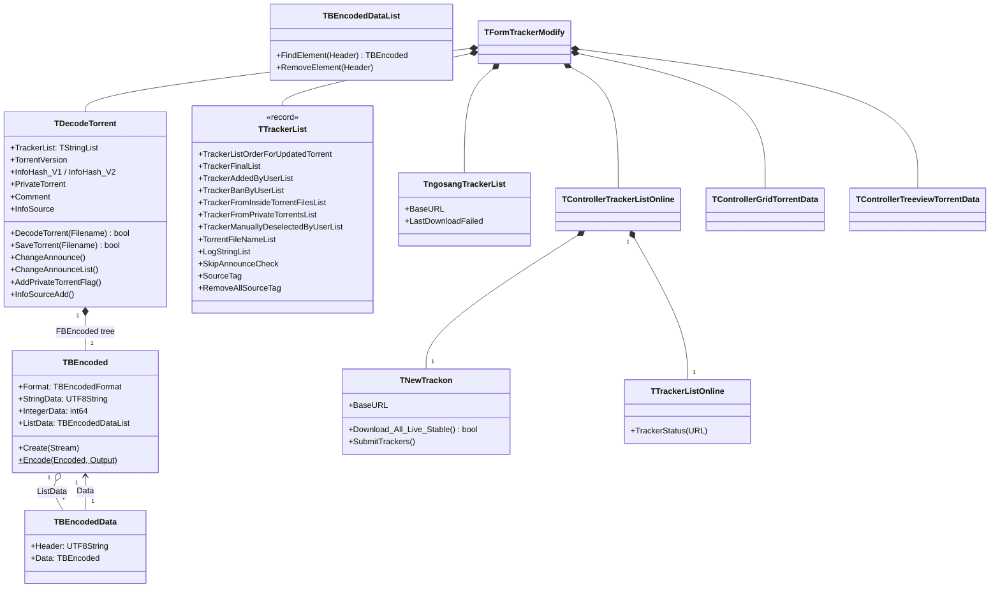
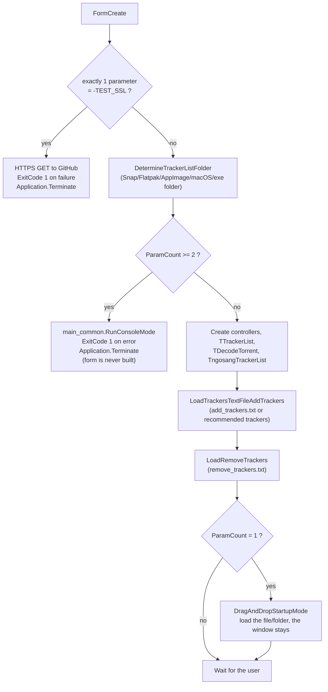

# Architecture
{: .no_toc }

1. TOC
{:toc}

## Repository layout

| Folder / file | Content |
|:--------------|:--------|
| `source/code/` | All the program units (`*.pas`) and the main form (`main.pas` + `main.lfm`). |
| `source/project/tracker_editor/` | Lazarus projects `trackereditor.lpi` (GUI) and `trackereditor_cli.lpi` (console only). |
| `source/project/unit_test/` | Lazarus project `tracker_editor_test.lpi` of the FPCUnit tests. |
| `source/test/` | The FPCUnit test units. |
| `submodule/dcpcrypt/` | Git submodule, the SHA256 of DCPcrypt2 (for the V2 info hash). Never modify it. |
| `enduser/` | Output folder of the executables **and** the files that are shipped to the user: `readme.txt`, `add_trackers.txt`, `remove_trackers.txt`. The CI adds `tracker-order-modes.svg` (copied from `docs/assets/`) to the release zips. |
| `test_torrent/` | Torrent files used by the tests (fixtures: no test may change them). |
| `lib/` | Compiled units (build output, not in git). |
| `metainfo/`, `snap/` | Linux packaging (Flathub/AppStream metadata, Snap). |
| `.github/workflows/` | CI/CD: Windows, macOS, Ubuntu (zip + AppImage), FreeBSD, Snap. |
| `docs/` | This documentation (GitHub Pages). |
| `Makefile` | GNU Make entry point for building and testing. |

## The three executables

One code base builds three programs. The `.lpr` file of each project is only a few lines: all the logic is in the units.

| Executable | Project | Uses a widgetset (LCL GUI) | Notes |
|:-----------|:--------|:--------------------------|:------|
| `trackereditor` | `trackereditor.lpi` / `.lpr` | yes | The GUI. With two or more parameters it behaves like a console program (the form is never built). |
| `trackereditor_cli` | `trackereditor_cli.lpi` / `.lpr` | **no** | Console only. `main_cli.pas` + `main_common.pas`. Windows and Linux only. No networking code (so no `-TEST_SSL`, no `fix_openssl`). |
| `test_trackereditor` | `tracker_editor_test.lpi` / `.lpr` | no (it starts the real executables) | FPCUnit console runner, built in the Debug mode. |

## Unit dependency graph

The arrows are the `uses` clauses (interface and implementation) between our own units. An arrow `A --> B` means *A uses B*.

How to read it:

- **Red** (`bencode`, `decodetorrent`, `trackerlist_online`): the *model*, no GUI.
- **Green** (`torrent_miscellaneous`, `update_torrent`, `main_common`, `main_cli`): the *engine*, shared by the GUI and the CLI. No GUI units either.
- **Pink** (`newtrackon`, `ngosang_trackerslist`, `fix_openssl`): network access.
- **Indigo** (`controller_*`, `controllergridtorrentdata`): the *controllers* between the model and the LCL grids and trees.
- **Blue** (`main`): the only unit that uses `Forms`.
- `trackereditor_cli` links only `main_cli`, `main_common`, `decodetorrent`, `bencode`, `torrent_miscellaneous`, `update_torrent` and `DCPsha256`. This is why it needs no widgetset.

{: .note }
`main` has a direct `uses` of `decodetorrent`, `torrent_miscellaneous` and `trackerlist_online` as well. The arrows from `main` to `update_torrent` and `main_common` are the engine calls that the GUI shares with the console.

## The layers

The rules (also in `.github/instructions/source-code.instructions.md`):

- **Never import upward.** `bencode` and `decodetorrent` must not know about `Forms`, `Controls` or `Grids`.
- `main.pas` is the **only** unit that imports `Forms`.
- `main.pas` cannot be unit tested. Put every decision of an event handler in a pure function in `main_common.pas` or `torrent_miscellaneous.pas`, and test that function.
- The console and the GUI share the engine; **do not copy engine code into `main.pas`**.

## The units, one by one

| Unit | Lines (approx.) | Layer | Responsibility | Key items |
|:-----|------:|:------|:---------------|:----------|
| `bencode.pas` | 369 | model | Bencode codec: decode a stream into a tree, encode a tree back to a string. Public domain origin, license `CC0-1.0`. | `TBEncoded`, `TBEncodedData`, `TBEncodedDataList`, `TBEncodedFormat` |
| `decodetorrent.pas` | 1075 | model | A torrent file: parse, read the properties, modify (announce, private flag, source, comment) and save. | `TDecodeTorrent`, `TTorrentVersion`, `BK_*` constants |
| `torrent_miscellaneous.pas` | 672 | engine | Everything about tracker lists that is not file format: the `TTrackerList` record, the order modes, URL validation, the console argument parser, the merge algorithm. | `TTrackerList`, `TTrackerListOrder`, `CombineFiveTrackerListToOne`, `ConsoleModeDecodeArguments`, `ValidateNewTrackerLines` |
| `update_torrent.pas` | 144 | engine | Writes the final tracker list (and the user settings) into every torrent file. | `UpdateTorrentFileList`, `TTorrentFileSetting`, `TUpdateTorrentResult` |
| `main_common.pas` | 466 | engine | The headless console engine, and the helper functions the GUI shares with it. | `RunConsoleMode`, `DetermineTrackerListFolder`, `CreateTrackerList`, `LoadAddTrackersRaw`, `LoadRemoveTrackers`, `SaveTrackerFinalListToFile` |
| `main_cli.pas` | 21 | entry | The entry point of `trackereditor_cli`. | `RunConsoleApplication` |
| `trackerlist_online.pas` | 78 | model | The online status of a tracker URL, from the newTrackon lists. | `TTrackerListOnline`, `TTrackerListOnlineStatus` |
| `newtrackon.pas` | 208 | network | Client of the newTrackon.com API (download lists, submit trackers). | `TNewTrackon`, `TNewTrackon_List` (`ntl_*`) |
| `ngosang_trackerslist.pas` | 121 | network | Client of the ngosang/trackerslist files on GitHub. | `TngosangTrackerList`, `Tngosang_List` (`ngl_*`) |
| `fix_openssl.pas` | 49 | network | Init-only unit: FPC 3.2.2 OpenSSL 3 detection workaround. | `{$IFDEF VER3_2_2}` blocks |
| `controllergridtorrentdata.pas` | 179 | controller | Fills the *Data/Info* grid; keeps the sort order undoable; reads the edited comment. | `TControllerGridTorrentData` |
| `controller_trackerlist_online.pas` | 167 | controller | The *Present trackers* grid (Keep / Online status / Tracker URL); the newTrackon download. | `TControllerTrackerListOnline` |
| `controller_treeview_torrent_data.pas` | 311 | controller | The *Files/Trackers/Info* tree with its popup menu. | `TControllerTreeviewTorrentData` |
| `main.pas` + `main.lfm` | 1361 + 497 | GUI | The form: menus, tabs, event handlers, drag and drop, orchestration. | `TFormTrackerModify` |

## Main classes and records

## What runs at start-up

`TFormTrackerModify.FormCreate` decides the mode of the program from the parameters:

`trackereditor_cli` does not have this: `main_cli.RunConsoleApplication` always calls `main_common.RunConsoleMode`.

See [Console mode](console-mode.html) and [GUI](gui.html) for the details of the two paths.

## Where the data lives (the one record to know)

Everything the update needs is in one record, `TTrackerList` (in `torrent_miscellaneous.pas`). It is created by `main_common.CreateTrackerList`, and the GUI and the console fill it in their own way. The merge algorithm only reads this record. See [Tracker pipeline](tracker-pipeline.html).
