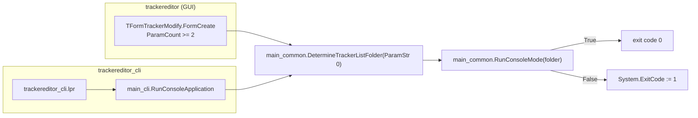
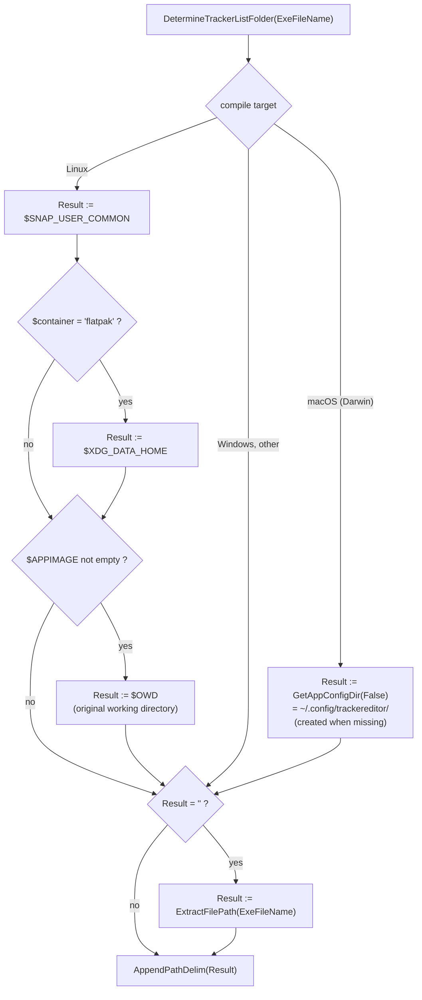
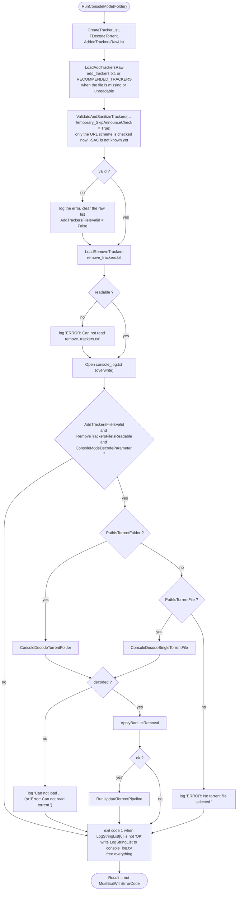
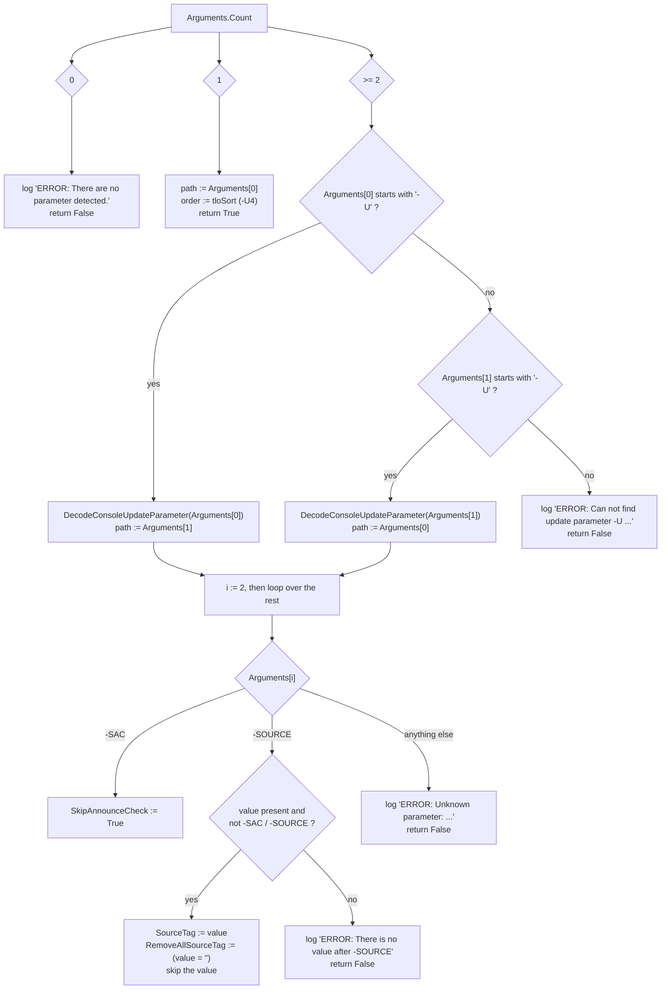

# Console mode: `main_common.pas` and `main_cli.pas`
{: .no_toc }

For the user view of the same feature, see [Console mode and parameters](../user/console-mode.html).

1. TOC
{:toc}

## Two entry points, one engine

- GUI program: `FormCreate` calls `RunConsoleMode` **first** when `ParamCount >= 2`, sets `ExitCode := 1` on failure, and calls `Application.Terminate`. The form is never built, and `FormShow` hides it if it is shown anyway.
- CLI program: `main_cli.RunConsoleApplication` does the same without any `Forms`/widgetset unit. It does not use `fix_openssl` and has no networking code.

`RunConsoleMode(const FolderForTrackerListLoadAndSave: string): boolean` reads `ParamStr`/`ParamCount` itself and returns `True` on success.

## Where the text files are: `DetermineTrackerListFolder`

The Linux rules are in a separate pure function, `PackagedTrackerListFolder(SnapUserCommon, Container, XdgDataHome, AppImage, OriginalWorkDir)`, so that they can be unit tested without setting environment variables. **The last rule that applies wins**: Snap, then Flatpak, then AppImage.

An AppImage must use `$OWD` because the AppImage is mounted read-only in a temporary location: the folder of the executable is useless.

## `RunConsoleMode` step by step

Notes:

- **Nothing is written to a torrent file** when `add_trackers.txt` is invalid, `remove_trackers.txt` is unreadable, a parameter is wrong, or any torrent file in the selection cannot be decoded. The first decode failure clears `TorrentFileNameList` and the tracker lists (`ConsoleDecodeTorrentFiles`).
- Any exception is caught: the exit code is set to 1 and `'ERROR: ' + E.Message` is inserted as **line 1** of the log, so an earlier `OK` cannot make it look like a success. If the log file cannot be written, the exit code is also 1.
- The log file is opened (and so truncated) **before** the arguments are decoded, so there is always a fresh log, also for a parameter error.
- A tracker that is in both `add_trackers.txt` and `remove_trackers.txt` is **not** added: `ApplyBanListRemoval` removes the banned trackers from the NEW list.

### `ApplyBanListRemoval`

The console equivalent of the GUI's `UpdateViewRemoveTracker`, but without a grid. It exits at once for `-U5` and `-U6`.

1. If `remove_trackers.txt` is present but empty: `TrackerManuallyDeselectedByUserList := TrackerFromInsideTorrentFilesList` (every tracker inside the torrents is "unchecked").
2. Validate the NEW list (now with the final `-SAC` state).
3. `RemoveTrackersFromList(TrackerBanByUserList, AddedTrackersRawList)`.
4. Validate and sanitize again.

### `RunUpdateTorrentPipeline`

1. No torrent file: log `ERROR: No torrent file selected`.
2. Validate the NEW list again (needed because `ApplyBanListRemoval` skips this for `-U5`/`-U6`).
3. `CombineFiveTrackerListToOne(tloSort, ...)` for the initial count.
4. `UpdateTorrentFileList(...)`. See [Tracker pipeline](tracker-pipeline.html).
5. `SaveTrackerFinalListToFile` writes `export_trackers.txt`.
6. Partial failures are logged: read-only files, files that failed to write, files that could not be decoded.
7. If the log is still empty: `OK`, the number of files, the number of trackers.

## Decoding the arguments

`ConsoleModeDecodeParameter` copies `ParamStr(1..ParamCount)` into a list and calls the testable `ConsoleModeDecodeArguments(Arguments, out FileNameOrDirStr, var TrackerList)` (`Arguments[0]` is the first parameter, so without the program name).

`DecodeConsoleUpdateParameter` accepts exactly three characters, `-U` plus one digit within `Ord(low(TTrackerListOrder))..Ord(high(TTrackerListOrder))`. So `-U8` and `-U10` fail with `ERROR: can not decode update parameter -U : ...`.

The same function is used by the GUI for the **one parameter** start (`DragAndDropStartupMode`), where it only returns the path.

{: .note }
The single parameter case defaults to `tloSort` "to keep the behaviour of the previous software version" (backward compatibility). `readme.txt` calls `-Ux` mandatory because that is the documented usage.

## Text files used by the console mode

| Constant (`torrent_miscellaneous.pas`) | File | Reader / writer |
|:----------------------------------------|:-----|:----------------|
| `FILE_NAME_ADD_TRACKERS` | `add_trackers.txt` | `ReadAddTrackersFile`, `LoadAddTrackersRaw` |
| `FILE_NAME_REMOVE_TRACKERS` | `remove_trackers.txt` | `LoadRemoveTrackers` |
| `FILE_NAME_EXPORT_TRACKERS` | `export_trackers.txt` | `SaveTrackerFinalListToFile` / `TrySaveTrackerFinalListToFile` |
| `FILE_NAME_CONSOLE_LOG` | `console_log.txt` | `RunConsoleMode` |
| `CONSOLE_SUCCESS_STATUS` | `OK` | first line of the log |

Design decisions that are tested (see `TTestStartUpParameterCli`):

- `remove_trackers.txt` lines are **not** validated as tracker URLs (unlike `add_trackers.txt`): a user may want to ban a malformed or obsolete URL that is still inside a torrent. A line that matches no tracker is skipped.
- An empty, existing `remove_trackers.txt` removes every tracker. A missing one removes nothing. An unreadable one aborts the run (a half read file must not remove anything).
- Console mode changes no torrent file when `add_trackers.txt` has an invalid URL.

## GUI and console: what is shared

| Shared function | Where | Used by the GUI in |
|:----------------|:------|:-------------------|
| `CreateTrackerList` / `FreeTrackerList` | `main_common` | `FormCreate` / `FormDestroy` |
| `DetermineTrackerListFolder` | `main_common` | `FormCreate` |
| `LoadAddTrackersRaw`, `ReadAddTrackersFile` | `main_common` | `LoadTrackersTextFileAddTrackers`, `MenuFileOpenTrackerListClick` |
| `LoadRemoveTrackers` | `main_common` | `FormCreate` |
| `TrySaveTrackerFinalListToFile` | `main_common` | `UpdateTorrent` |
| `ValidateNewTrackerLines` | `torrent_miscellaneous` | `CopyUserInputNewTrackersToList` |
| `AddTorrentFileTrackers` | `torrent_miscellaneous` | `UpdateTorrentTrackerList` |
| `ConsoleModeDecodeParameter` | `torrent_miscellaneous` | `DragAndDropStartupMode` |
| `CombineFiveTrackerListToOne`, `UpdateTorrentFileList` | `torrent_miscellaneous`, `update_torrent` | `UpdateTorrent` |

What is **not** shared (because the GUI has a grid and dialogs): decoding and showing the torrents (`AddTorrentFileList`, `ViewUpdate*`), `UpdateViewRemoveTracker` (unchecks rows, console equivalent is `ApplyBanListRemoval`), the confirmation dialogs.

## Tests

`source/test/test_start_up_parameter.pas`:

- `TTestStartUpParameter` starts the real GUI executable with parameters (console mode needs no display).
- `TTestStartUpParameterCli` descends from it and starts `trackereditor_cli`. It adds the CLI specific tests.
- The tests run in their own temporary folder with a copy of the program and of `test_torrent/*.torrent`. Parameters are quoted (`QuoteParameter`) so paths with spaces work.
- Tests that download from the internet are skipped (`Ignore`) when the server cannot be reached.
