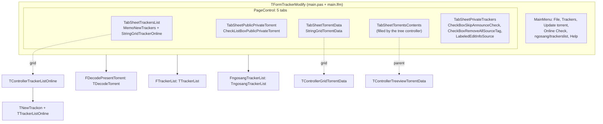
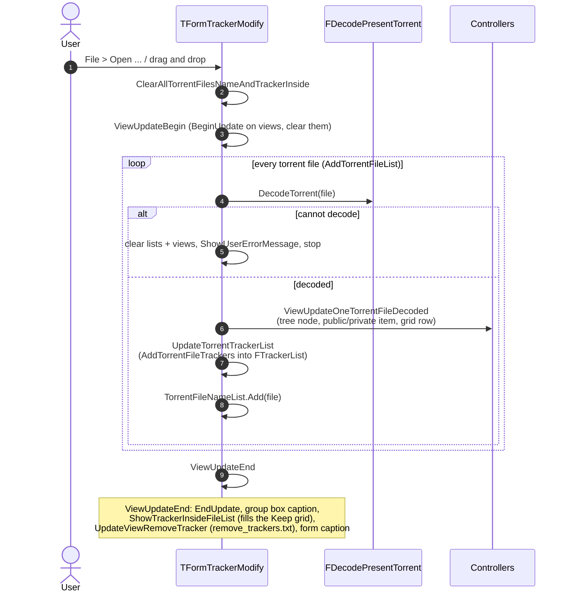
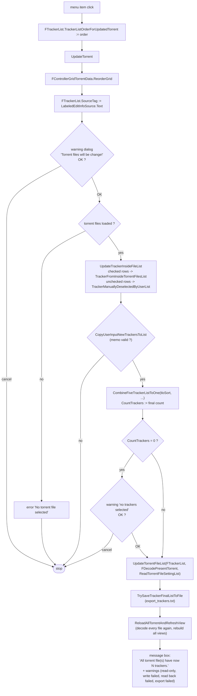

# GUI: `main.pas`, `main.lfm` and the controllers
{: .no_toc }

For the user view of the same window, see the [GUI guide](../user/gui.html).

1. TOC
{:toc}

## Overview

`main.pas` is a thin orchestrator. The rule: **no decisions in the event handlers that can be a pure function**. `main.pas` cannot be unit tested; `main_common.pas` and `torrent_miscellaneous.pas` can.

### Fields of `TFormTrackerModify`

| Field | Type | Role |
|:------|:-----|:-----|
| `FTrackerList` | `TTrackerList` | The shared record, see [Tracker pipeline](tracker-pipeline.html). |
| `FDecodePresentTorrent` | `TDecodeTorrent` | One decoder object that is reused for every torrent file (load, view, update). |
| `FControllerTrackerListOnline` | `TControllerTrackerListOnline` | The *Keep / Online status / Tracker URL* grid. |
| `FControllerGridTorrentData` | `TControllerGridTorrentData` | The *Data/Info* grid. |
| `FControllerTreeviewTorrentData` | `TControllerTreeviewTorrentData` | The *Files/Trackers/Info* tree. |
| `FngosangTrackerList` | `TngosangTrackerList` | Downloads the ngosang lists. |
| `FDownloadStatus` | `boolean` | The newTrackon lists are downloaded. |
| `FDragAndDropStartUp` | `boolean` | Started with one parameter. While true the announce check is relaxed so that a drag and drop never fails on it. Reset at the end of `FormCreate`. |
| `FConsoleMode` | `boolean` | Two or more parameters. |
| `FFilePresentBanByUserList` | `boolean` | `remove_trackers.txt` exists (an empty file is meaningful). |
| `FFolderForTrackerListLoadAndSave` | `string` | Result of `DetermineTrackerListFolder`. |

## The index invariant

Four views describe the same torrent files and are matched **by index**:

| Place | Item for torrent number *i* (0 based) |
|:------|:---------------------------------------|
| `FTrackerList.TorrentFileNameList` | `[i]` |
| `CheckListBoxPublicPrivateTorrent` | item `i` (the public/private checkbox) |
| `StringGridTorrentData` | row `i + 1` (row 0 is the header). The user may sort it. |
| `FControllerTreeviewTorrentData` | child `i` of the root node |

`ReadTorrentFileSettingList` builds the `TTorrentFileSettingArray` by index. Before it runs, `FControllerGridTorrentData.ReorderGrid` sorts the grid back to load order using the hidden *IndexOrder* column, otherwise the edited comments would be written to the wrong torrent.
If a torrent fails to load, every view is cleared (`ClearTorrentFilesView`) so the indices never drift. After an update, a file that cannot be read back is deleted from `TorrentFileNameList` for the same reason.

## Loading torrent files

Entry points that end in `AddTorrentFileList`:

| Entry | Handler |
|:------|:--------|
| *File > Open one torrent file* | `MenuOpenTorrentFileClick` |
| *File > Open multiple torrent files inside one folder* | `MenuFileTorrentFolderClick` (uses `torrent_miscellaneous.LoadTorrentViaDir`) |
| Drag and drop (also from the program icon: one parameter) | `FormDropFiles`, `DragAndDropStartupMode` |

`FormDropFiles` sorts the dropped items: a folder (checked first because a folder name may contain a dot), a `.torrent` file, or a `.txt` file (its trackers are appended to the memo after `SanitizeTrackerList`). The first torrent item clears the previously loaded torrents. If the dropped `.txt` makes the memo invalid, the previous memo text is restored.

## Updating the torrent files: `UpdateTorrent`

All eight *Update torrent* menu items only set `FTrackerList.TrackerListOrderForUpdatedTorrent` and call `UpdateTorrent`.

Important details:

- The hour glass cursor is reset in a `finally` block, so every `exit` is safe.
- The message depends on the order mode: for `-U5`/`-U6` ("remove nothing") the tracker count is meaningless (every torrent differs), so the message is *All torrent file(s) are updated.*
- The grid *Keep* column drives `TrackerFromInsideTorrentFilesList`. That is why, in the GUI, an unchecked tracker is not part of **U** (the "others") either.

## `TControllerTrackerListOnline`: the Keep grid

- Three columns: `Keep` (checkbox column, cell text `'1'`/`'0'`), `Online status` (hidden until a download succeeds), `Tracker URL`.
- It is built on `FTrackerList.TrackerFromInsideTorrentFilesList` (passed in the constructor) and a callback `TDefaultChecked` (`TFormTrackerModify.TrackerWithURLAndAnnounce`) that decides the initial check state: a URL with a wrong scheme, or without `/announce` while the announce check is on, starts unchecked.
- `UpdateView` clears the grid and appends one row per tracker with the status from `TTrackerListOnline.TrackerStatus`.
- It **owns** a `TNewTrackon` and a `TTrackerListOnline`; the latter shares the three `TStringList`s of the former (`Live`, `Dead`, `Stable`). `DownloadTrackers_All_Live_Stable` downloads, refreshes the view and shows the status column.
- Alternating row colour is disabled for a dark theme (`IsDarkTheme`): the text would be invisible on Linux and macOS.
- `SubmitTrackers` forwards to `TNewTrackon.SubmitTrackers`.

## `TControllerGridTorrentData`: the Data/Info grid

- 13 columns, defined in `main.lfm` (design time), in this fixed order: `TorrentFile`, `InfoFileName`, `TorrentVersion`, `Padding`, `InfoHash`, `CreatedOn`, `CreatedBy`, `Comment`, `PrivateTorrent`, `InfoSource`, `PieceLength`, `TotalSize`, `IndexOrder` (hidden).
- The form fills the public string properties for one torrent, then calls `AppendRow`.
- The user can **move columns**. `StringGridTorrentDataColRowMoved` only sets a flag; `UpdateColumnTag` then writes the real position of every column into its `Tag`, and `WriteCell` / `ReadComment` use that `Tag`. That is why the code uses `Column.Tag` and not a fixed column number.
- `ReorderGrid` sorts the hidden `IndexOrder` column ascending to restore the load order.
- Only the *Comment* column is editable (the grid has `goEditing`, other columns are `ReadOnly`).

## `TControllerTreeviewTorrentData`: the tree

- Created on `TabSheetTorrentsContents`; it creates its own `TGroupBox` + `TTreeView` + popup menu at run time.
- Structure: root node *Torrent Files* → one node per torrent → three children in this order: `Files V1/V2`, `Trackers`, `Info`. The menu `Tag` values (`ctv_ShowAllFiles = 0`, `ctv_ShowAllTrackers = 1`, `ctv_ShowAllInfo = 2`) are the **child index**, so the order of creation must not change.
- `BeginUpdate` clears the tree, `AddOneTorrentFileDecoded` adds one torrent, `EndUpdate` writes the totals in the group box caption and synchronises the popup menu.

## Menu handlers that talk to the network

| Handler | Calls | On failure |
|:--------|:------|:----------|
| `MenuItemOnlineCheckDownloadNewTrackonClick` | `FControllerTrackerListOnline.DownloadTrackers_All_Live_Stable` | error message |
| `MenuItemOnlineCheckAppendStableTrackersClick` | download if `not FDownloadStatus`, then `AppendTrackersToMemoNewTrackers(StableTrackers)` | |
| `MenuTrackersDeleteTrackersWithStatusClick` | download if needed; **exit** when it failed (all statuses would be `Unknown`); then unchecks the rows of the status given by `Sender.Tag` (0 = Unstable, 1 = Dead, 2 = Unknown) | error message |
| `MenuItemOnlineCheckSubmitNewTrackonClick` | `GetTrackersForOnlineSubmit` (never private trackers), then `SubmitTrackers` | error message |
| `MenuItemNgosangAppend*Click` | `AppendNgosangTrackersToMemoNewTrackers(list)`: checks `LastDownloadFailed` first | error message |

`AppendTrackersToMemoNewTrackers` appends to the memo and validates it with `CopyUserInputNewTrackersToList`; when invalid, the memo text from before is restored.

## Resource file `main.lfm`

`main.lfm` holds the layout, the captions and the `OnClick` bindings. After you edit it in the Lazarus IDE, check that the captions that the user manual documents did not change: see [Maintaining this documentation](docs-maintenance.html).

`PROGRAM_VERSION` (`main.pas`, implementation section) is the version number shown in the window caption. Change it for a release, together with `docs/history.md`.
