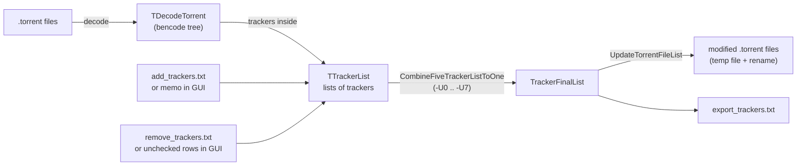

# Programmer guide

How the source code of **bittorrent-tracker-editor** works. Read this before you change the code: it saves you the time to study the inner working.

The program is written in Free Pascal with the Lazarus LCL (ObjFPC mode, UTF-8 strings). All the code is in [`source/code/`](https://github.com/GerryFerdinandus/bittorrent-tracker-editor/tree/main/source/code).

## Suggested reading order

1. [Architecture](architecture.html): the three executables, every unit, and the `uses` graph. Start here.
2. [Torrent file format](torrent-format.html): `bencode.pas` and `decodetorrent.pas`.
3. [Tracker pipeline](tracker-pipeline.html): `TTrackerList`, `CombineFiveTrackerListToOne` and `update_torrent.pas`. This is the heart of the program.
4. [Console mode](console-mode.html): `main_common.pas`, `main_cli.pas`, argument decoding, exit codes.
5. [GUI](gui.html): `main.pas`, `main.lfm` and the three controllers.
6. [Online services](online-services.html): newTrackon, ngosang, tracker status, OpenSSL.
7. [Build and test](build-and-test.html): Makefile, lazbuild, FPCUnit, WSL, CI.
8. [Conventions and design decisions](conventions.html): style rules and the known (accepted) minor issues.
9. [Maintaining this documentation](docs-maintenance.html): how the site is built and which file must be kept in sync with which.

## The ten second summary

