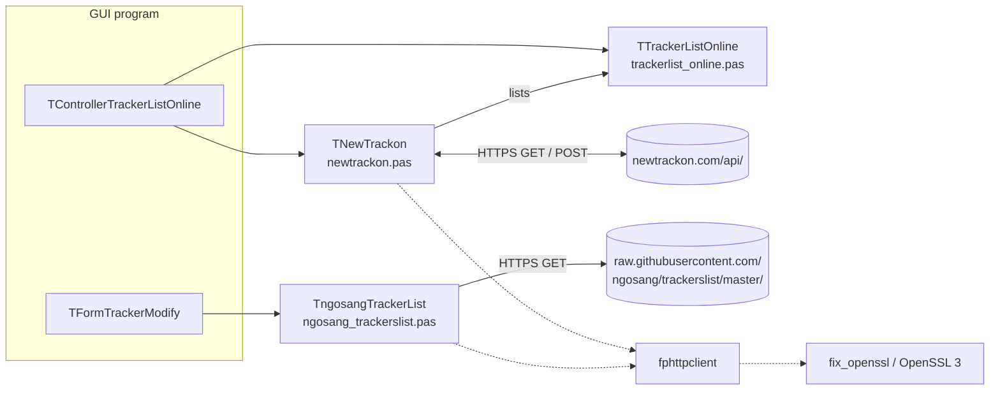
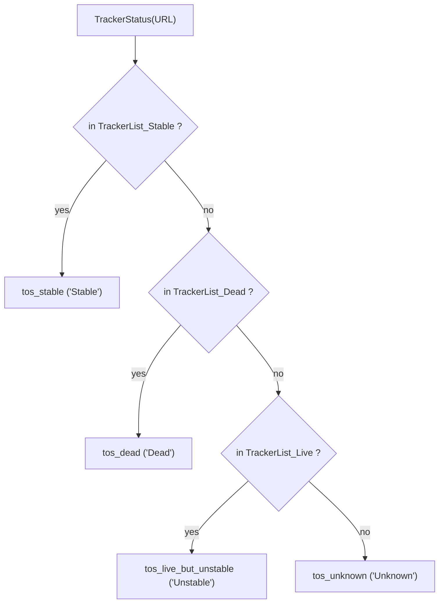

# Online services: newTrackon, ngosang, tracker status, OpenSSL
{: .no_toc }

The GUI (only) can talk to two web services and uses the answer to help the user choose trackers.

1. TOC
{:toc}

Both clients:

- use `TFPHTTPClient` (`fphttpclient`) with `ConnectTimeout = 10000` ms and `IOTimeout = 15000` ms, so a stalled server cannot freeze the UI for ever,
- run **synchronously** on the main thread (the GUI shows an hour glass cursor),
- never raise an exception to the caller: they return `False` (newTrackon) or set `LastDownloadFailed` (ngosang),
- clean every downloaded list with `torrent_miscellaneous.SanitizeTrackerList`,
- have a **`BaseURL` property** (a test seam). The unit tests set it to `http://999.999.999.999/` to force a failing download without a network.

## `newtrackon.pas`: `TNewTrackon`

API of <https://newtrackon.com/api/>. The lists are in an array indexed by `TNewTrackon_List`:

| Enum | API name | Property | Meaning |
|:-----|:---------|:---------|:--------|
| `ntl_URL_All` | `all` | `TrackerList_All` | All known trackers, dead or alive. |
| `ntl_URL_Live` | `live` | `TrackerList_Live` | Currently active and responding. |
| `ntl_URL_Stable` | `stable` | `TrackerList_Stable` | Uptime of 95% or more. |
| `ntl_URL_UDP` | `udp` | `TrackerList_Udp` | Stable UDP trackers. |
| `ntl_URL_HTTP` | `http` | `TrackerList_Http` | Stable HTTP(S) trackers. |
| `ntl_CREATE_DEAD` | (none) | `TrackerList_Dead` | **Not downloaded**: `All - Live`, made by `CreateTrackerList_Dead`. |

{: .warning }
`API_NAME` must be in **the same order** as the enum (there is a comment in the code). Add a new list to both.

| Method | Behavior |
|:-------|:---------|
| `Download_All_Live_Stable` | Downloads `all`, `stable`, `live` (what the GUI needs), then `CreateTrackerList_Dead`. Stops at the first failure. |
| `DownloadEverything` | All six lists, in enum order. |
| `SubmitTrackers(List, out SendCount)` | 1) Downloads `all` again (to compare with the most recent list). 2) Removes the trackers newTrackon already knows. 3) `SendCount` := what is left. 4) If anything is left, `FormPost` to `<BaseURL>add` with `new_trackers=<url>+<url>...` (each URL `HTTPEncode`d, separated by `+`). The result is `True` only for HTTP status **204**. |

**Privacy:** the caller (the form) must build `List` with `GetTrackersForOnlineSubmit`, which removes every tracker that comes from a **private torrent** (`TrackerFromPrivateTorrentsList`): such a URL can contain the user's passkey. This holds even if the same URL is also in a public torrent. The form reports how many URLs were not sent.

## `trackerlist_online.pas`: `TTrackerListOnline`

A tiny class that turns three lists into a status.

The three lists are *shared pointers* to the lists inside `TNewTrackon` (`TControllerTrackerListOnline` assigns them in its constructor), so a new download updates the status without copying. A list that is `nil` is skipped. `TrackerListOnlineStatusToString` gives the text of the grid.

The order of the checks matters: *Stable* before *Dead* before *Live*.

## `ngosang_trackerslist.pas`: `TngosangTrackerList`

Reads the ready made lists of <https://github.com/ngosang/trackerslist>.

| Property | File |
|:---------|:-----|
| `TrackerList_Blacklist` | `blacklist.txt` |
| `TrackerList_All` | `trackers_all.txt` |
| `TrackerList_All_HTTP` / `_HTTPS` / `_UDP` / `_WS` / `_IP` | `trackers_all_http.txt` / `..._https.txt` / `..._udp.txt` / `..._ws.txt` / `..._ip.txt` |
| `TrackerList_Best` / `TrackerList_Best_IP` | `trackers_best.txt` / `trackers_best_ip.txt` |

- **Lazy:** every property is an *indexed read property* with the method `DownloadTracker`: reading the property **downloads the list at that moment**.
- `LastDownloadFailed` is reset at every download. An empty list can also be a valid answer, so the caller must read `LastDownloadFailed` **after** reading the list property (the form does so in `AppendNgosangTrackersToMemoNewTrackers`).
- The `FILE_NAME` array must be in the same order as `Tngosang_List`.
- The blacklist is not used by the GUI; it is for the console workflows (see the user guide examples).

## `fix_openssl.pas`

An *init-only* unit (it has only an `initialization` section). It is in the GUI project and in the test project, **not** in `trackereditor_cli` (which has no networking code).

HTTPS needs OpenSSL 3. Free Pascal 3.2.2 does not know it yet, so under `{$IFDEF VER3_2_2}` the unit patches the library names that the FPC `openssl` unit searches:

| Target | Patch |
|:-------|:------|
| Windows | `DLLSSLName3 := 'libssl-3-x64.dll'` (or `libssl-3.dll`) and `DLLUtilName2 := 'libcrypto-3-x64.dll'` (or `libcrypto-3.dll`). |
| macOS (Darwin) | Rewrites the `OpenSSL.DLLVersions` list (LibreSSL .48 ... .35, OpenSSL `.3`, `.1.1`, ... `.0.9.8`). |
| Linux, other Unix | The last entry of `OpenSSL.DLLVersions` becomes `.3`. |

Keep the unit until the minimum FPC version has OpenSSL 3 detection. The Windows release zip contains the two DLLs (`libssl-3-x64.dll`, `libcrypto-3-x64.dll`); the CI downloads them from the V1.32.0 release.

### `-TEST_SSL`

`trackereditor -TEST_SSL` (GUI program only, exactly one parameter) does a `TFPCustomHTTPClient.SimpleGet` of the GitHub README, sets `ExitCode := 1` when it fails, and terminates. CI uses it to prove that the packaged program (also the AppImage) can use HTTPS: `xvfb-run --auto-servernum enduser/trackereditor -TEST_SSL`.

## Tests

| Suite | Notes |
|:------|:------|
| `TTestTrackerListOnline` | Pure logic, no network. |
| `TTestNewTrackon`, `TTestNgosangTrackersList` | Download from the internet; **skipped (`Ignore`) when the server is unreachable**. Test the failure path through `BaseURL`. |
| `TTestStartUpParameter.Test_Parameter_TEST_SSL` | Starts the real program with `-TEST_SSL`. |
