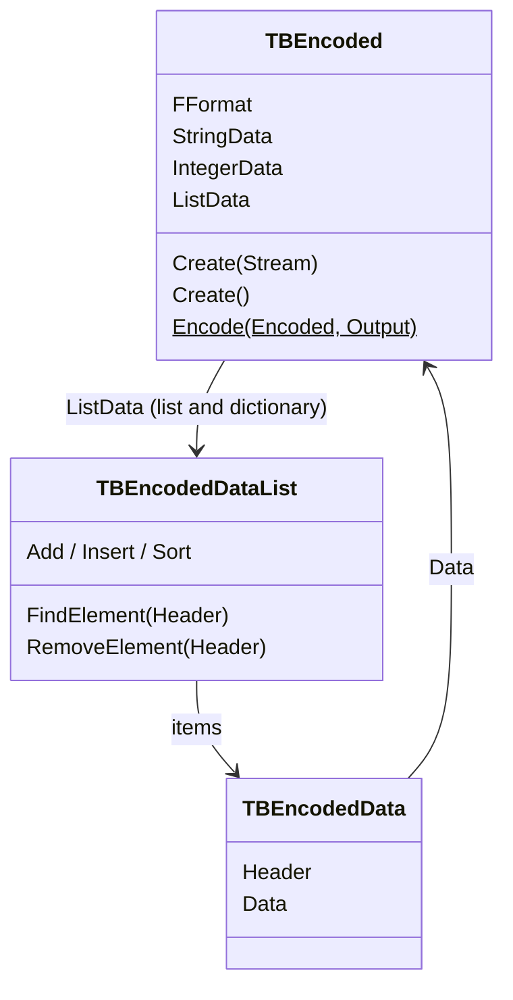
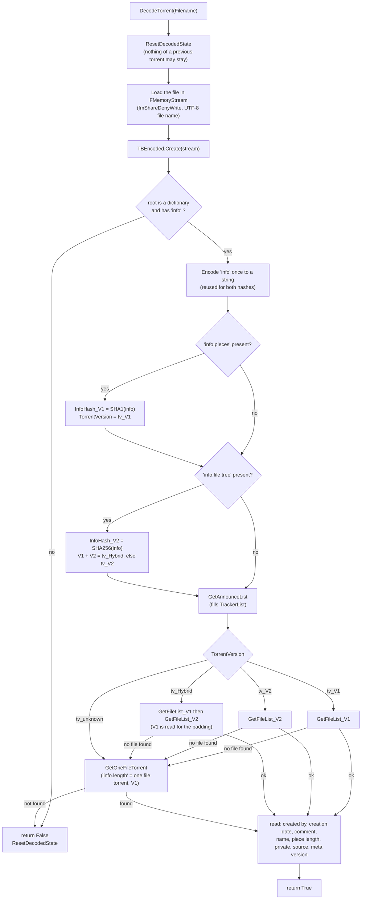
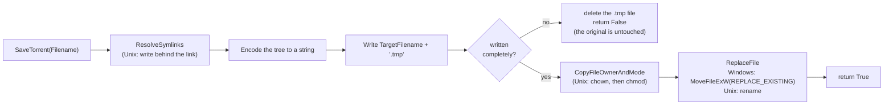

# Torrent file format: `bencode.pas` and `decodetorrent.pas`
{: .no_toc }

These two units are the *model*. They know nothing about the tracker lists, the GUI or the console. They read a `.torrent` file, give access to its properties, change a few of them, and write the file back.

1. TOC
{:toc}

## Bencode in two minutes

A torrent file is one **bencoded dictionary**. Bencode has four value types:

| Type | Encoding | Example | `TBEncodedFormat` |
|:-----|:---------|:--------|:------------------|
| string | `<length>:<bytes>` | `4:spam` | `befString` |
| integer | `i<number>e` | `i42e` | `befInteger` |
| list | `l<values>e` | `l4:spami42ee` | `befList` |
| dictionary | `d<key><value>...e` (keys are strings, sorted by raw bytes) | `d3:cow3:mooe` | `befDictionary` |

(`befEmpty` is the state of a `TBEncoded` before it gets a format.)

A simplified torrent file looks like this:

```text
d
  8:announce       -> string   "udp://tracker.example/announce"
  13:announce-list -> list of lists of strings (the tiers)
  7:comment        -> string
  10:created by    -> string
  13:creation date -> integer
  4:info           -> dictionary
        4:name          -> string
        12:piece length -> integer
        6:pieces        -> string (V1: SHA1 of all pieces)
        5:files         -> list of dictionaries (V1, multi file)  or  6:length (V1, one file)
        9:file tree     -> dictionary (V2)
        12:meta version -> integer 2 (V2)
        7:private       -> integer 1 (private torrent)
        6:source        -> string (private tracker tag)
e
```

## `bencode.pas`



- One node is a `TBEncoded`. The `Format` property tells which of `StringData`, `IntegerData` or `ListData` is valid. Setting `Format` to `befList` or `befDictionary` creates the `ListData` list.
- `ListData` is a `TBEncodedDataList` (a `TObjectList`) of `TBEncodedData`. For a **list** the `Header` of each item is empty; for a **dictionary** the `Header` is the key and `Data` is the value.
- `TBEncoded.Create(Stream)` parses recursively. A string, an integer, a list or a dictionary is chosen by the first byte (`0`..`9`, `i`, `l`, `d`).
- `TBEncoded.Encode(Node, Output)` is the reverse. It writes the dictionary keys **in the order of the list**, so an unchanged tree is encoded to exactly the same bytes (this keeps the info hash correct).

Safety rules of the parser (a damaged torrent must never crash the program or allocate gigabytes):

| Rule | Detail |
|:-----|:-------|
| Nesting | At most `MAX_NESTING_DEPTH = 256` levels (every level is a recursive call). |
| Strings | The length must be digits only, at most 10 digits, not larger than the data left in the stream. Checked **before** `SetLength`. |
| Integers | BEP 3: no leading zero, no `-0`, `-` only at the start. |
| Dictionary key | Must start with a digit (it is a string). |
| Any violation | Raises an exception. `TDecodeTorrent` catches it and reports `False`. |

{: .warning }
`TBEncodedDataList.FindElement` compares the key **case insensitive** (it lower-cases both sides). Do not rely on it to tell `Name` from `name`.

## `decodetorrent.pas`

`TDecodeTorrent` owns one bencode tree (`FBEncoded`) and a set of already decoded properties.

### Constants instead of magic strings

All the dictionary keys are named constants `BK_*` in the implementation section: `BK_ANNOUNCE`, `BK_ANNOUNCE_LIST`, `BK_INFO`, `BK_COMMENT`, `BK_CREATED_BY`, `BK_CREATION_DATE` (root level), `BK_FILES`, `BK_FILE_TREE`, `BK_LENGTH`, `BK_NAME`, `BK_PRIVATE`, `BK_SOURCE`, `BK_META_VERSION`, `BK_PIECE_LENGTH`, `BK_PIECES` (info level), `BK_PATH`, `BK_ATTR` (file entries). Always use them.

### Decoding a file



Facts to remember:

- **Version detection:** V1 = `info.pieces` exists. V2 = `info.file tree` exists. Both = hybrid. For a hybrid torrent the GUI shows only the V2 hash.
- **Info hash:** SHA1 (`SHA1` unit of FPC) of the *re-encoded* `info` dictionary for V1, SHA256 (`DCPsha256` from the submodule) for V2. Because `Encode` keeps the order of keys, this equals the hash of the original bytes for a normal torrent.
- **The hash is lazy after a change.** `RemovePrivateTorrentFlag`, `InfoSourceRemove` and friends set `FInfoHashDirty`. The `InfoHash_V1` / `InfoHash_V2` getters call `RefreshInfoHashes`, which recomputes the hashes only when someone reads them.
- **A failed decode resets everything** (`ResetDecodedState`). There is never a half decoded torrent, and no pointer into a freed tree.
- **The file list** is only for display: file names, lengths, the total size (padding files are not counted) and the padding flag. It is not used for the tracker update.
- A torrent without any file list and without `info.length` is rejected.

### Trackers inside a torrent

`GetAnnounceList` fills the public `TrackerList` (a `TStringList`, not sorted, `dupIgnore`):

1. The string `announce` (when it is not empty: an empty `announce` is used by trackerless torrents).
2. The **first** tracker of every tier of `announce-list`. Empty tiers and non-string items are skipped.

{: .note }
**Design choice:** BEP 12 allows several trackers per tier. This program treats every tracker as equal, so it reads only the first tracker of each tier and **writes every tracker back as its own tier** (`ChangeAnnounceList`). See [Conventions](conventions.html).

### Changing a torrent

| Method | Effect on the bencode tree |
|:-------|:---------------------------|
| `RemoveAnnounce`, `RemoveAnnounceList` | Removes the key from the root dictionary. |
| `ChangeAnnounce(URL)` | Removes `announce`, adds a new one, sorts the keys. |
| `ChangeAnnounceList(List)` | Removes `announce-list`, creates a list of lists (one tracker per tier), sorts the keys. |
| `AddPrivateTorrentFlag` / `RemovePrivateTorrentFlag` | Adds `info.private = 1`, or removes it. Adding does nothing when the torrent is already private (re-sorting `info` could change the hash). |
| `InfoSourceAdd(Value)` / `InfoSourceRemove` | Same for `info.source`. Nothing is done when the same value is already there. |
| `Comment := ...` (property) | Sets, creates (when missing) or removes (when empty) the root `comment`. |

After adding a key, the dictionary is sorted with `Sort_` that compares the keys as **raw bytes** (`CompareStr`). Bencode requires that order; a locale aware compare would break it.

### Saving a file



The original file is replaced in one step, so a failed write never damages a torrent. The owner, group and permissions stay the same; a symbolic link stays a symbolic link.

## Tests

| Unit under test | Test unit | Suite |
|:----------------|:----------|:------|
| `bencode` | `test_bencode.pas` | `TTestBEncode` |
| `decodetorrent` | `test_decodetorrent.pas` | `TTestDecodeTorrent` |

The torrent files in `test_torrent/` are fixtures (V1, V2 and hybrid). No test may change them.
