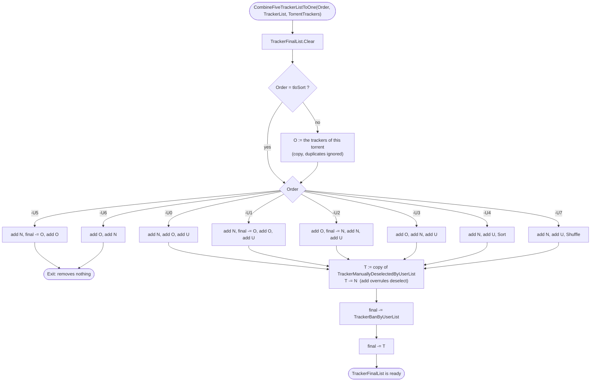
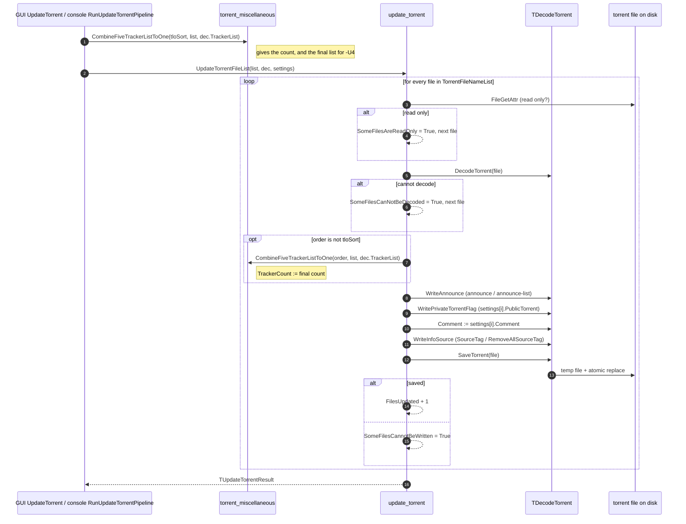

# Tracker pipeline: from tracker lists to modified torrent files
{: .no_toc }

This is the heart of the program. The GUI and the console fill the same record (`TTrackerList`), call the same merge function (`CombineFiveTrackerListToOne`) and the same writer (`UpdateTorrentFileList`).

1. TOC
{:toc}

## The record `TTrackerList`

Defined in `torrent_miscellaneous.pas`. Created by `main_common.CreateTrackerList`, released by `FreeTrackerList`. All the lists are `TStringList` with `Duplicates = dupIgnore`.

| Field | Sorted | Meaning | Filled by (console) | Filled by (GUI) |
|:------|:------:|:--------|:--------------------|:----------------|
| `TrackerListOrderForUpdatedTorrent` | | The order mode: `-U0`...`-U7` as `TTrackerListOrder`. | `DecodeConsoleUpdateParameter` | The *Update torrent* menu item that was clicked. |
| `TrackerAddedByUserList` | no | The **NEW** trackers. Validated. | `add_trackers.txt` | The *Add new trackers* memo (`CopyUserInputNewTrackersToList`). |
| `TrackerBanByUserList` | no | Trackers that must not be in a torrent. | `remove_trackers.txt` | `remove_trackers.txt` |
| `TrackerFromInsideTorrentFilesList` | yes | The union of the trackers of **all** loaded torrent files. | `AddTorrentFileTrackers` for every file | Rebuilt from the **checked** rows of the grid just before the update (`UpdateTrackerInsideFileList`). |
| `TrackerFromPrivateTorrentsList` | yes | The part of the list above that comes from **private** torrents. Never sent to newTrackon. | `AddTorrentFileTrackers` | `AddTorrentFileTrackers` |
| `TrackerManuallyDeselectedByUserList` | no | Trackers the user does not want. | All trackers when `remove_trackers.txt` is present but empty, else empty. | The **unchecked** rows of the grid. |
| `TorrentFileNameList` | no | The files that will be updated. | The decoded files | The loaded files |
| `TrackerFinalList` | no | **The result**: what goes into the torrent files. | `CombineFiveTrackerListToOne` | `CombineFiveTrackerListToOne` |
| `LogStringList` | | The lines of `console_log.txt`. | `LogConsoleError`, `OK` | not used |
| `SkipAnnounceCheck` | | `-SAC` | `-SAC` | The checkbox |
| `SourceTag`, `RemoveAllSourceTag` | | `-SOURCE` | `-SOURCE` | The edit box and the checkbox |

The name of the function says it: **five lists become one**.

## The formula

```text
TrackerFinalList =
      ( TrackerFromOneTorrentFile      <- the trackers of the torrent being updated
      + TrackerAddedByUserList         <- NEW
      + TrackerFromInsideTorrentFilesList )  <- the union of all torrents ("others")
      - TrackerBanByUserList           <- remove_trackers.txt
      - TrackerManuallyDeselectedByUserList  <- unchecked / "remove all"
```

The `+` is an *ordered, duplicate free append*, and the position of each part depends on the order mode. The two `-` steps are **skipped** in the two *remove nothing* modes (`-U5`, `-U6`).
A tracker that is in `TrackerAddedByUserList` is never removed by the manual deselection: *add* overrules *deselect*. (It is still removed by `TrackerBanByUserList`.)

## `CombineFiveTrackerListToOne`

```pascal
procedure CombineFiveTrackerListToOne(TrackerListOrder: TTrackerListOrder;
  var TrackerList: TTrackerList; PresentTorrentTrackerList: TStringList);
```

`PresentTorrentTrackerList` is `TDecodeTorrent.TrackerList` of the torrent that is being updated. For `tloSort` and `tloRandomize` it is **not used** (those two use only the global lists).

### Per mode

Notation: **N** = `TrackerAddedByUserList`, **O** = the trackers of this torrent, **U** = `TrackerFromInsideTorrentFilesList`.
`add(x)` is *append when not yet in the list*. `final -= x` removes the trackers of `x` from the final list.

| Mode (enum) | Steps |
|:------------|:------|
| `-U0` `tloInsertNewBeforeAndKeepNewIntact` | `add(N)`, `add(O)`, `add(U)` |
| `-U1` `tloInsertNewBeforeAndKeepOriginalIntact` | `add(N)`, `final -= O`, `add(O)`, `add(U)` |
| `-U2` `tloAppendNewAfterAndKeepNewIntact` | `add(O)`, `final -= N`, `add(N)`, `add(U)` |
| `-U3` `tloAppendNewAfterAndKeepOriginalIntact` | `add(O)`, `add(N)`, `add(U)` |
| `-U4` `tloSort` | `add(N)`, `add(U)`, **sort** |
| `-U5` `tloInsertNewBeforeAndKeepOriginalIntactAndRemoveNothing` | `add(N)`, `final -= O`, `add(O)`. **Return** (no removal). |
| `-U6` `tloAppendNewAfterAndKeepOriginalIntactAndRemoveNothing` | `add(O)`, `add(N)`. **Return** (no removal). |
| `-U7` `tloRandomize` | `add(N)`, `add(U)`, **shuffle** (Fisher-Yates) |

For every mode except `-U5` and `-U6`, the function then removes `TrackerBanByUserList` and `TrackerManuallyDeselectedByUserList` (minus `N`) from the final list.

{: .note }
`TTrackerListOrder` is ordered `-U0`...`-U7` as `0`..`7`: **do not reorder the enum**. `DecodeConsoleUpdateParameter` converts the digit to the enum with `TTrackerListOrder(i)`.

### The algorithm as a flowchart



## `UpdateTorrentFileList` (`update_torrent.pas`)

```pascal
function UpdateTorrentFileList(var TrackerList: TTrackerList;
  DecodeTorrent: TDecodeTorrent;
  const FileSettingList: TTorrentFileSettingArray): TUpdateTorrentResult;
```

`FileSettingList` has one `TTorrentFileSetting` (`PublicTorrent: boolean`, `Comment: UTF8String`) for each file of `TorrentFileNameList`, in the same order.

**Precondition:** the caller has already called `CombineFiveTrackerListToOne(tloSort, ...)`. That gives the correct `TrackerFinalList.Count` (used as the result when no file is written) and, **for `tloSort`**, the final list that is written to *every* file. This is why `-U4` gives all torrents the same list. For every other mode the final list is calculated again for each torrent file, because it depends on `O`.



### How the announce is written (`WriteAnnounce`)

| Final list has | `announce` | `announce-list` |
|:--------------:|:-----------|:----------------|
| 0 trackers | removed | removed |
| 1 tracker | that tracker | removed |
| 2 or more | the first tracker | all trackers, **one tracker per tier** |

### Other settings written per file

- **Public/private:** `PublicTorrent = True` removes `info.private` when the torrent is private; `False` adds it.
- **Comment:** from the Data/Info grid in the GUI; in console mode the decoded original comment is written back (not edited).
- **Source tag:** `RemoveAllSourceTag` removes `info.source`; a non empty `SourceTag` sets it; an empty tag changes nothing.
  (`-SOURCE ""` sets `RemoveAllSourceTag := True` in `ConsoleModeDecodeArguments`.)

### The result record

`TUpdateTorrentResult`: `TrackerCount`, `FilesUpdated`, `SomeFilesAreReadOnly`, `SomeFilesCannotBeWritten`, `SomeFilesCanNotBeDecoded`. The caller turns the booleans into warnings (GUI message box) or error lines (`console_log.txt`).

## Validation of the NEW trackers

`ValidateNewTrackerLines(Lines, SkipAnnounceCheck, AddedList, out ErrorStr, out FailedTracker)`:

1. Trim every line, skip empty lines.
2. `ValidTrackerURL`: must start with one of `VALID_TRACKERS_URL` (`udp://`, `http://`, `https://`, `ws://`, `wss://`). The scheme must be **lower case**.
3. Unless `SkipAnnounceCheck` or a WebTorrent URL (`ws://`, `wss://`): `TrackerURLWithAnnounce` (ends with `/announce` or `/announce.php`).
4. `AddButIgnoreDuplicates(AddedList, URL)`.
5. The first failure returns `False` with the message and the line.

`SanitizeTrackerList` (used for every file that is read) trims each line and cuts everything after the first space or tab (comments).

## Helper functions

| Function | Purpose |
|:---------|:--------|
| `AddButIgnoreDuplicates(List, Str)` | A not-sorted `TStringList` ignores duplicates only through `IndexOf`; a sorted one does it itself. This function hides the difference. |
| `RemoveTrackersFromList(RemoveList, List)` | Removes every tracker of `RemoveList` from `List`. |
| `RandomizeTrackerList(List)` | Fisher-Yates shuffle. |
| `AddTorrentFileTrackers(Decoded, Private, TrackerList)` | Adds the trackers of one decoded torrent to `TrackerFromInsideTorrentFilesList`, and also to `TrackerFromPrivateTorrentsList` when the torrent is private. |
| `GetTrackersForOnlineSubmit(TrackerList, SubmitList)` | `TrackerFromInsideTorrentFilesList` minus `TrackerFromPrivateTorrentsList`: the trackers that may be sent to newTrackon. |
| `TrackerDependsOnSkipAnnounceCheck(URL)` | A valid URL that is only accepted with `-SAC` (no `/announce`, not WebTorrent). The GUI uses it to follow the checkbox. |
| `PathIsTorrentFile`, `PathIsTrackerListFile`, `PathIsTorrentFolder` | Extension tests, case insensitive (`.TORRENT` on Linux). A path without extension is treated as a folder. |
| `LoadTorrentViaDir(Dir, List)` | Lists the `.torrent` files of one folder (no sub folders). The extension is checked in code because a `*.torrent` mask is case sensitive on Linux. |

## Tests

`test_torrent_miscellaneous.pas` (`TTestTorrentMiscellaneous`) has one test per order mode (`Test_Combine_U0_...` to `Test_Combine_U7_...`), the argument decoder and the validation. `test_update_torrent.pas` (`TTestUpdateTorrent`) tests the writer on real torrent files.
