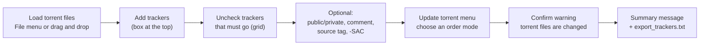

# GUI guide
{: .no_toc }

This page describes the window of the program `trackereditor`: the five tabs, every menu item, and how to load files.

1. TOC
{:toc}

*Screenshot of an older version (1.32.0). The new tabs and menu items are described below.*

{: .warning }
There is **no undo** and no backup function. The torrent files are changed on disk when you select an item of the *Update torrent* menu. Make a copy of your torrent files first.

## Quick start

1. Start the program.
2. Load torrent files: drag and drop a torrent file or a folder with torrent files on the window (or use the menu *File*).
3. On the tab **Trackers List**: type or paste the trackers you want to add in the upper box, and uncheck the trackers in the lower grid that you want to remove.
4. Select one of the items in the menu **Update torrent**. Confirm the warning.

## The window

The title of the window shows the program version, the LCL and FPC (compiler) version, and how many torrent files are loaded, for example *Bittorrent tracker editor (1.33.1/LCL 3.6.0.0/FPC 3.2.2)( Torrent files: 12 )*. When *Skip Announce Check* is active, `(-SAC)` is added.

The window has a menu and five tabs:

| Tab | Purpose |
|:----|:--------|
| [Trackers List](#tab-trackers-list) | The trackers to add, and the trackers present inside the torrent files (keep or remove). |
| [Public/Private](#tab-publicprivate) | Change the public/private flag of each torrent. |
| [Data/Info](#tab-datainfo) | A table with the properties of every torrent. The comment can be edited. |
| [Files/Trackers/Info](#tab-filestrackersinfo) | A tree with the content of every torrent. |
| [Private Trackers](#tab-private-trackers) | Skip Announce Check and the *info source* tag. |

## Loading torrent files

### Menu File

| Menu item | What it does |
|:----------|:-------------|
| **Open one torrent file** | Select one `.torrent` file. |
| **Open multiple torrent files inside one folder** | Select a folder. All the `.torrent` files inside that folder are loaded. (Sub folders are not searched.) |
| **Open tracker file list** | Select a `.txt` file with trackers. It replaces the text in the *Add new trackers* box. |

Loading torrent files replaces the torrent files that were loaded before. If you cancel the dialog, the loaded files stay.
If one of the torrent files cannot be read, the program shows the error and loads **none** of the files of that selection.

### Drag and drop

You can drop on the window:

- one or more `.torrent` files,
- a folder with torrent files (a mix of files and folders is accepted),
- one or more `.txt` files with trackers: the trackers are **appended** to the *Add new trackers* box.

Torrent files and `.txt` files can be dropped together.

### Start the program with a file or folder

If you start `trackereditor` with exactly **one** parameter (a torrent file or a folder), the window opens and loads it. This is what happens when you drag a file or folder on the program icon or on a shortcut.
With **two or more** parameters the program runs in the [console mode](console-mode.html) and shows no window. See also [Console mode](console-mode.html#what-about-one-parameter).

### Startup files

At the start the program reads two optional files, see [Files and folders](files-and-folders.html):

- `add_trackers.txt`: shown in the *Add new trackers* box. If the file is missing, three recommended trackers are shown instead.
- `remove_trackers.txt`: after you load torrent files, the trackers in this file are unchecked in the grid and removed from the *Add new trackers* box. If the file exists but is **empty**, **all** trackers are unchecked.

## Tab: Trackers List

The tab has two parts.

### Add new trackers to torrent file(s).

A text box with **one tracker URL per line**. These are the trackers that will be added to all the loaded torrent files.

- A URL must begin with `udp://`, `http://`, `https://`, `ws://` or `wss://`.
- A URL must end with `/announce` or `/announce.php`, except WebTorrent (`ws://`, `wss://`) URLs, or when *Skip Announce Check* is on (tab [Private Trackers](#tab-private-trackers)).
- Text after a space or tab is a comment and is removed.
- Duplicates and empty lines are removed.

A wrong URL gives an error message when you update the torrent files (and when you append trackers from a menu: the previous text is then restored).

### Present trackers in all torrent files. Select the one that you want to keep.

A grid with the trackers found inside **all** the loaded torrent files (every tracker once). The group title also shows the *List count*.

| Column | Meaning |
|:-------|:--------|
| **Keep** | Checkbox. A checked tracker is kept (and added to all torrent files). An unchecked tracker is removed from all torrent files. |
| **Online status** | Only visible after the status is downloaded from newTrackon (menu *Online Check*). See below. |
| **Tracker URL** | The URL. |

A tracker with a wrong URL format is **unchecked by default** (for example a URL without `/announce`, unless Skip Announce Check is on).

Online status values:

| Status | Meaning |
|:-------|:--------|
| Stable | Most of the time present online (an uptime of 95% or more). |
| Unstable | Is online, but not stable. |
| Dead | Was alive once, but no longer responds. |
| Unknown | The tracker is not in the newTrackon database. |

## Tab: Public/Private

A list with every loaded torrent file and a checkbox. **A checked item is a public torrent.** Uncheck it to make the torrent *private*.

{: .warning }
Changing the public/private flag changes the **info hash** of the torrent. It becomes a different torrent for the BitTorrent network.

## Tab: Data/Info

A table with one row for each torrent file.

| Column | Content |
|:-------|:--------|
| Torrent File | The file name. |
| Info Filename | The name inside the torrent (`info.name`). |
| Torrent Version | V1, V2 or hybrid (V1 + V2). |
| Padding (beb 47) | Whether the torrent has padding files (BEP 47). |
| Info Hash | The V1 hash, or the V2 hash for V2 and hybrid torrents. |
| Created On | The creation date. |
| Created By | The program that created the torrent. |
| Comment (can be edited) | The comment. **You can edit it**: the new comment is saved when you update the torrent. |
| Private | `yes` or `no`. |
| Source | The *info source* tag (private trackers). |
| Piece Length (KiB) | Size of one piece. |
| Total size (KiB) | The size of all the files inside the torrent. |

Click a column header to sort the table. You can drag the columns to another position.

## Tab: Files/Trackers/Info

A tree with, for every torrent file, three branches: the **Files**, the **Trackers** and the **Info** of the torrent. The header of the torrent shows its version, size, number of files and number of trackers. The title of the box shows the total number of files and their size.

Click the tree with the **right mouse button** for a popup menu:

| Popup item | What it does |
|:-----------|:-------------|
| Show Everything | Expand all branches. |
| Hide All | Collapse all, only the torrent file names stay visible. |
| Show All Files | Show/hide the files branch (checkbox). |
| Show All Trackers | Show/hide the trackers branch (checkbox). |
| Show All Info | Show/hide the info branch (checkbox). |

## Tab: Private Trackers

Items for private trackers.

| Item | What it does |
|:-----|:-------------|
| **Skip Announce Check in the URL (-SAC)** | Private tracker URLs may not end with `/announce`. Check this box to accept such URLs. The trackers without `/announce` in the grid follow this setting (checked or unchecked). Same as the console parameter `-SAC`. |
| **Remove all source tag** | Remove the `info source` tag from all torrent files. |
| **Add/Change source tag value: (-SOURCE)** | The *info source* tag to write in all torrent files. Keep it empty if you do not want to add or change anything. Same as the console parameter `-SOURCE`. |

{: .warning }
Changing the source tag changes the **info hash** of the torrent.

## Menu Trackers

Works on the trackers in the grid of the tab *Trackers List*.

| Menu item | What it does |
|:----------|:-------------|
| **Keep all the present trackers** | Check all the trackers in the grid. |
| **Delete all the present trackers** | Uncheck all the trackers in the grid. (Use it to create trackerless torrents, or to replace all trackers by your own list.) |
| **Delete UNSTABLE trackers (Data from newTrackon)** | Uncheck all trackers with the status *Unstable*. |
| **Delete DEAD trackers (Data from newTrackon)** | Uncheck all trackers with the status *Dead*. |
| **Delete UNKNOWN trackers (Data from newTrackon)** | Uncheck all trackers with the status *Unknown*. |
| **All torrent are public** | Check all items of the tab *Public/Private* (after a confirmation). |
| **All torrent are private** | Uncheck all items of the tab *Public/Private* (after a confirmation). |

The three *Delete ... (Data from newTrackon)* items download the status from newTrackon first if that was not done yet. If the download fails, an error is shown and nothing is unchecked.

## Menu Update torrent

This is the menu that **changes the torrent files**. Every item is one of the [tracker order modes](tracker-order-modes.html). A confirmation (*Torrent files will be change! Warning: There is no undo.*) is shown first.

| Menu item | Console |
|:----------|:--------|
| Insert new trackers list **BEFORE**, the original trackers list inside the torrent file | |
| &nbsp;&nbsp;And remove possible duplicated trackers from the ORIGINAL trackers list. | `-U0` |
| &nbsp;&nbsp;And remove possible duplicated trackers from the NEW trackers list. | `-U1` |
| &nbsp;&nbsp;Keep original tracker list unchanged and remove nothing. | `-U5` |
| Append new trackers list **AFTER**, the original trackers list inside the torrent file. | |
| &nbsp;&nbsp;And remove possible duplicated trackers from the ORIGINAL trackers list. | `-U2` |
| &nbsp;&nbsp;And remove possible duplicated trackers from the NEW trackers list. | `-U3` |
| &nbsp;&nbsp;Keep original tracker list unchanged and remove nothing. | `-U6` |
| **Sort the trackers list by name.** | `-U4` |
| **Randomize the trackers list.** | `-U7` |

What happens when you select an item:

1. The confirmation is shown. *Cancel* stops everything.
2. If no torrent file is loaded, an error is shown.
3. The *Add new trackers* box is checked. A wrong URL gives an error and nothing is changed.
4. The checked trackers of the grid and the new trackers are combined into the final list, in the selected order.
5. If the final list is **empty**, a warning asks whether you really want torrent files without any tracker (DHT torrents).
6. Every torrent file is written: the trackers, the public/private flag, the comment and the source tag. Read-only files are skipped.
7. The final list is written to `export_trackers.txt` ([Files and folders](files-and-folders.html)).
8. All torrent files are read again and the tabs show the result.
9. A message shows how many trackers each torrent file now has (or *All torrent file(s) are updated.* for the *remove nothing* modes), with a warning when:
   - some torrent files are read-only,
   - some torrent files could not be written,
   - some torrent files could not be read back,
   - `export_trackers.txt` could not be written.

## Menu Online Check (newTrackon)

[newTrackon](https://newtrackon.com) is a service that tests public trackers. These items need an internet connection.

| Menu item | What it does |
|:----------|:-------------|
| **Check Status Trackers (From newTrackon)** | Download the lists of newTrackon and show the *Online status* column in the grid. |
| **Append Stable Trackers (From newTrackon)** | Append all the stable trackers to the *Add new trackers* box (downloads the lists first if needed). |
| **Upload trackers to newTrackon** | Send the trackers of your torrent files to newTrackon, so they will be tested. Only the trackers that newTrackon does not know yet are sent. The number of sent trackers is shown. |

{: .note }
Trackers from **private** torrents are **never** uploaded: their URL can contain your passkey. This is also the case when the same URL is inside a public torrent. The message tells how many were not sent.

## Menu ngosang/trackerslist

Download a ready made tracker list from the GitHub project [ngosang/trackerslist](https://github.com/ngosang/trackerslist) and **append** it to the *Add new trackers* box.

| Menu item | List |
|:----------|:-----|
| Append best | `trackers_best.txt` |
| Append all | `trackers_all.txt` |
| Append all udp | `trackers_all_udp.txt` |
| Append all http | `trackers_all_http.txt` |
| Append all https | `trackers_all_https.txt` |
| Append all ws | `trackers_all_ws.txt` |
| Append best ip | `trackers_best_ip.txt` |
| Append all ip | `trackers_all_ip.txt` |

If the download fails, an error is shown. If the list contains an invalid URL, the previous text of the box is restored.

## Menu Help

| Menu item | What it does |
|:----------|:-------------|
| **Visit website tracker editor** | Open the GitHub project page. |
| **Reporting Issue** | Open the GitHub issue page. |
| **Visit website newTrackon** | Open <https://newtrackon.com/>. |
| **Visit website ngosang (github)** | Open <https://github.com/ngosang/trackerslist>. |

## Tips

- The first menu letters are keyboard accelerators (for example `Alt+F` for *File*, `Alt+U` for *Update torrent*).
- On the first start the window is as small as allowed. Make it bigger to see more of the tables.
- To check that the program can connect to the internet with HTTPS, see [Troubleshooting](troubleshooting.html#the-download-from-newtrackon-or-ngosang-fails).

