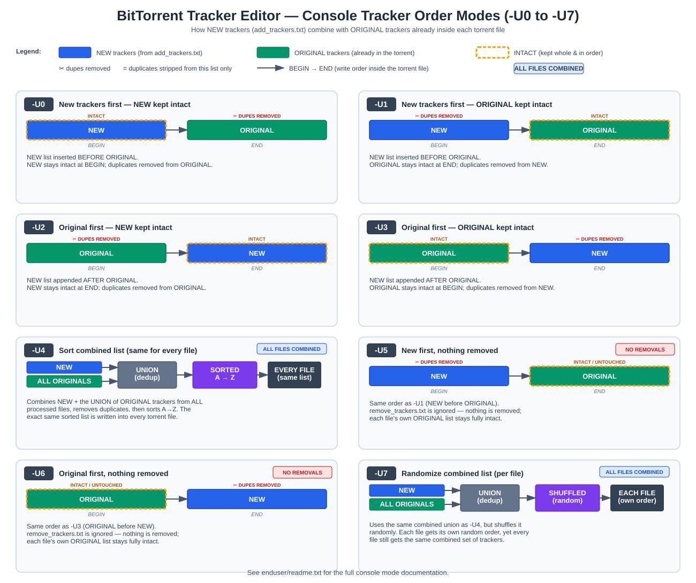
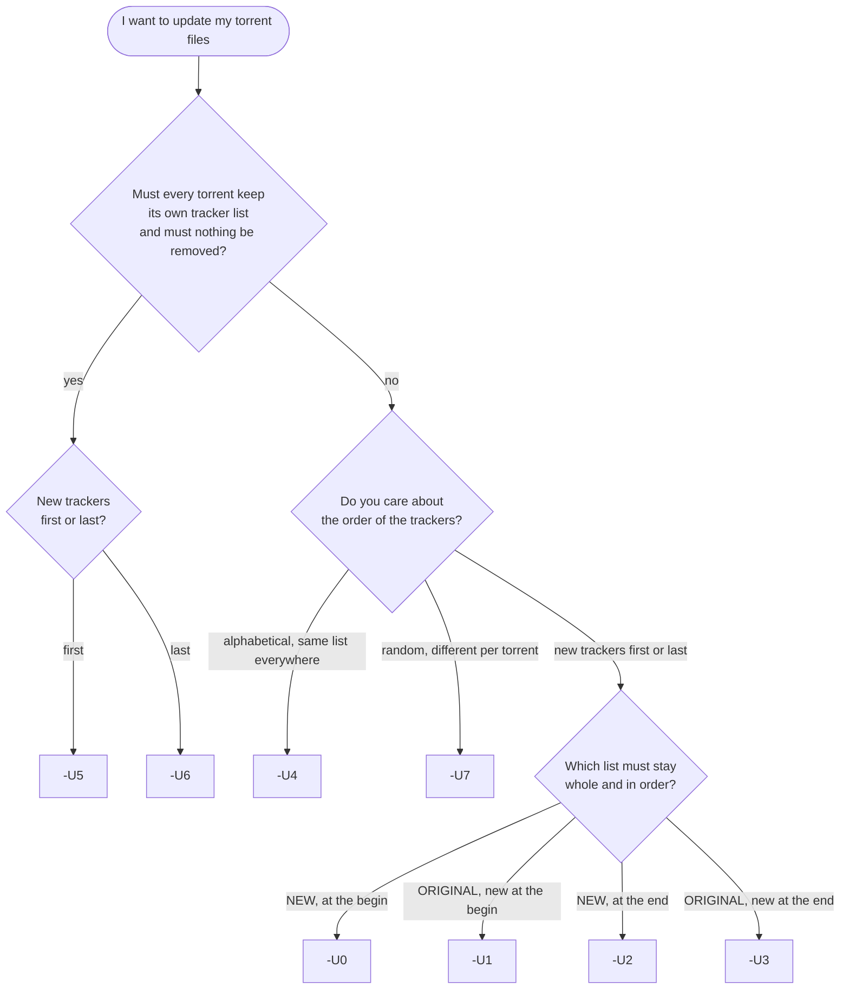

# Tracker order modes (`-U0` to `-U7`)
{: .no_toc }

When the program updates a torrent file, it must decide **which trackers** go into the file and **in which order**. This is the *tracker order mode*.
In console mode you choose it with the mandatory `-Ux` parameter. In the GUI you choose it with the items of the *Update torrent* menu. They are the same eight modes.

1. TOC
{:toc}

## Words used

| Word | Meaning |
|:-----|:--------|
| **NEW** trackers | The trackers from `add_trackers.txt` (console) or from the *Add new trackers* box (GUI). |
| **ORIGINAL** trackers | The trackers already present inside the torrent file that is being updated. |
| **intact** | The list stays together as one complete unbroken block, in its original order, at its named position (BEGIN or END) of the final list. |
| duplicate | A tracker that is in both the NEW and the ORIGINAL list. It is always removed from the **other** (non intact) list, never from the intact one. |

## Overview

## The eight modes

| Console | GUI menu: *Update torrent* | NEW position | What is kept intact | Duplicates removed from |
|:--------|:---------------------------|:-------------|:--------------------|:------------------------|
| `-U0` | Insert new trackers list BEFORE ... And remove possible duplicated trackers from the ORIGINAL trackers list | BEGIN | NEW | ORIGINAL |
| `-U1` | Insert new trackers list BEFORE ... And remove possible duplicated trackers from the NEW trackers list | BEGIN | ORIGINAL | NEW |
| `-U2` | Append new trackers list AFTER ... And remove possible duplicated trackers from the ORIGINAL trackers list | END | NEW | ORIGINAL |
| `-U3` | Append new trackers list AFTER ... And remove possible duplicated trackers from the NEW trackers list | END | ORIGINAL | NEW |
| `-U4` | Sort the trackers list by name | n/a | n/a | n/a |
| `-U5` | Insert ... BEFORE ... Keep original tracker list unchanged and remove nothing | BEGIN | ORIGINAL (of each torrent) | NEW |
| `-U6` | Append ... AFTER ... Keep original tracker list unchanged and remove nothing | END | ORIGINAL (of each torrent) | NEW |
| `-U7` | Randomize the trackers list | n/a | n/a | n/a |

### -U0

Insert the NEW trackers list BEFORE the ORIGINAL trackers list inside the torrent file.
The NEW trackers list is kept intact at the BEGIN. Duplicated trackers are removed from the ORIGINAL trackers list.

### -U1

Insert the NEW trackers list BEFORE the ORIGINAL trackers list inside the torrent file.
The ORIGINAL trackers list is kept intact at the END. Duplicated trackers are removed from the NEW trackers list.

### -U2

Append the NEW trackers list AFTER the ORIGINAL trackers list inside the torrent file.
The NEW trackers list is kept intact at the END. Duplicated trackers are removed from the ORIGINAL trackers list.

### -U3

Append the NEW trackers list AFTER the ORIGINAL trackers list inside the torrent file.
The ORIGINAL trackers list is kept intact at the BEGIN. Duplicated trackers are removed from the NEW trackers list.

### -U4

Sort the trackers list by name.
It builds **ONE** combined list: the NEW trackers list plus the UNION of the ORIGINAL trackers found across **ALL** the torrent files being processed (not just each file's own trackers), duplicates removed.
This combined list is sorted once, and the exact **same** sorted list is written into every processed torrent file.
Every torrent file ends up with an identical tracker list, even if their original tracker lists were different from each other.

### -U5

Insert the NEW trackers list BEFORE the ORIGINAL trackers list inside the torrent file.
Keep the original tracker list unchanged and **remove nothing**. Each torrent file keeps its own original tracker list, even if they differ per file.
Same duplicate removal rule as `-U1`: duplicated trackers are removed from the NEW trackers list, the ORIGINAL trackers list of each torrent stays fully intact.

### -U6

Append the NEW trackers list AFTER the ORIGINAL trackers list inside the torrent file.
Keep the original tracker list unchanged and **remove nothing**. Each torrent file keeps its own original tracker list, even if they differ per file.
Same duplicate removal rule as `-U3`: duplicated trackers are removed from the NEW trackers list, the ORIGINAL trackers list of each torrent stays fully intact.

### -U7

Randomize the trackers list.
It uses the same combined list as `-U4` (the NEW trackers list plus the UNION of the ORIGINAL trackers found across ALL the torrent files being processed, duplicates removed), but shuffles it into a random order instead of sorting it.
The random order is shuffled again for each torrent file, so every file gets a different order, but every file still gets the same combined set of trackers.

## Example

NEW trackers (`add_trackers.txt`): `X1`, `X2`.
The torrent file being updated has the ORIGINAL trackers `A1`, `X2`, `A2` (note that `X2` is a duplicate). No other torrent files, no `remove_trackers.txt`.

| Mode | Final list inside the torrent |
|:-----|:------------------------------|
| `-U0` | `X1` `X2` `A1` `A2` |
| `-U1` | `X1` `A1` `X2` `A2` |
| `-U2` | `A1` `A2` `X1` `X2` |
| `-U3` | `A1` `X2` `A2` `X1` |
| `-U4` | `A1` `A2` `X1` `X2` (sorted by name) |
| `-U5` | `X1` `A1` `X2` `A2` |
| `-U6` | `A1` `X2` `A2` `X1` |
| `-U7` | the same four trackers in a random order |

## Which mode do I need?

{: .note }
With `-U0` to `-U3`, the trackers that come from the **other** torrent files (and that you did not remove) are appended at the end of the list of each torrent, after the ORIGINAL and the NEW trackers.
If you do not want this, remove them with `remove_trackers.txt` (console) or uncheck them (GUI), or use `-U5` or `-U6`: these two never add the trackers of other torrent files.

{: .warning }
In console mode `remove_trackers.txt` is ignored in the modes `-U5` and `-U6`: they remove nothing.

The programmer documentation of the algorithm is in [Tracker pipeline](../developer/tracker-pipeline.html).
